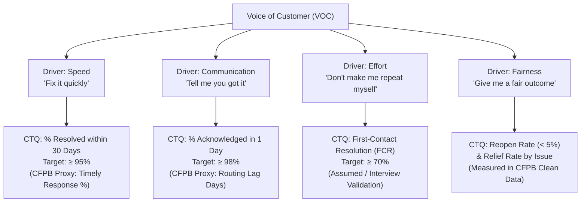

# Critical to Quality (CTQ) Tree: Voice of Customer Translation

> **Purpose:** Translates qualitative Voice of the Customer (VOC) statements into measurable operational drivers, CTQ metrics, target thresholds, and empirical data sources.

---

---

## CTQ Matrix & Translation Table

| Customer Need (In Their Words) | Underlying Quality Driver | Specific CTQ Metric | Target Threshold | Measurable in Empirical Dataset? | Operational Implication for Kestrel Bank |
|---|---|---|---|---|---|
| **"Fix it quickly"** | **Speed** | % cases resolved within 30 calendar days | **≥ 95%** | **Proxy:** Measured via `Timely response?` (CFPB 15-day company response window) | Statutory mandate under RB-IOS 2026. Delays beyond 30 days trigger immediate right of customer escalation to RBI Ombudsman. |
| **"Tell me you got it"** | **Communication** | % acknowledged with tracking ID within 1 working day | **≥ 98%** | **Proxy:** Measured via `routing_lag_days` (Received to Sent-to-company interval) | Unacknowledged tickets create customer anxiety, triggering repeat calls into call centers and inflating ticket counts. |
| **"Don't make me repeat myself"** | **Effort (Friction)** | First-Contact Resolution (FCR) rate | **≥ 70%** | **No** (Assumed / Process interview validation) | Multi-hop transfers across departments (e.g., Branch → Cards → Fraud) inflate handling time and drive customer rage. |
| **"Give me a fair outcome"** | **Fairness & Justice** | 1. Post-closure reopen rate 2. Relief rate by issue | **Reopen < 5%** **Relief: Tracked by issue** | **Yes:** `relief` flag (`Closed with monetary relief` or `non-monetary relief`) | High relief rate in specific categories (e.g., fee disputes) indicates the bank was at fault or policy was opaque. |
