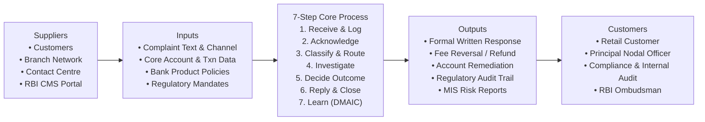

# SIPOC: Kestrel Bank Retail Complaint Handling

> **Purpose:** High-level operational view mapping Suppliers, Inputs, Process Steps, Outputs, and Customers across Kestrel Bank's retail checking, savings, and credit card complaint workflows.

---

---

## Detailed SIPOC Breakdown

| Component | Detailed Items | Operational Notes / Observations |
|---|---|---|
| **Suppliers** | • Retail & Card Customers • Branch Relationship Managers • Tier-1 Call Centre Agents • RBI Complaint Management System (CMS) | Inbound complaints arrive through distributed channels; web and digital forms dominate volume (~80%+). |
| **Inputs** | • Free-form consumer narrative • Product & issue classification tags • Customer identity & account numbers • Transaction ledger & dispute history • Internal policy manuals & RBI circulars | Inputs often contain unstructured, emotionally charged consumer descriptions with sensitive personal data (PII) requiring masking. |
| **Process (High Level)** | **1. Receive and Log:** Ingest from portal/branch into CRM ticket. **2. Acknowledge:** Issue automated confirmation and tracking ID within 1 working day. **3. Classify and Route:** Triage complaint to specialized unit (Cards, Accounts, Fraud, Escalations). **4. Investigate:** Frontline agent reviews transaction logs, policies, and card network chargeback rules (AHT ~25 min). **5. Decide Outcome:** Determine financial relief, non-monetary correction, or formal explanation. **6. Reply and Close:** Draft regulatory-compliant closure letter and execute relief within RB-IOS 30-day limit. **7. Learn:** Synthesize defect data into monthly operational risk and product engineering reviews. | Current investigation (Step 4) and drafting (Step 6) consume the vast majority of agent handling capacity. |
| **Outputs** | • Formal resolution letter / email • Financial relief credit (monetary adjustment) • Account unfreeze / card replacement (non-monetary) • Updated CRM case history and closed ticket • Regulatory compliance reporting logs | Outputs must meet strict statutory fairness and documentation standards under RB-IOS 2026. |
| **Customers** | • Aggrieved Bank Customer • Principal Nodal Officer (Internal) • Chief Risk Officer & Legal Counsel • Reserve Bank of India (Ombudsman) | The ultimate stakeholder is both the customer (retention) and the regulator (statutory compliance and zero Ombudsman awards). |
