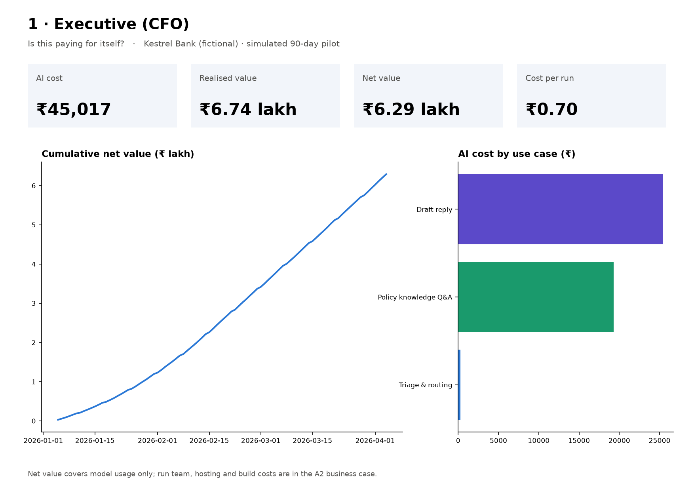
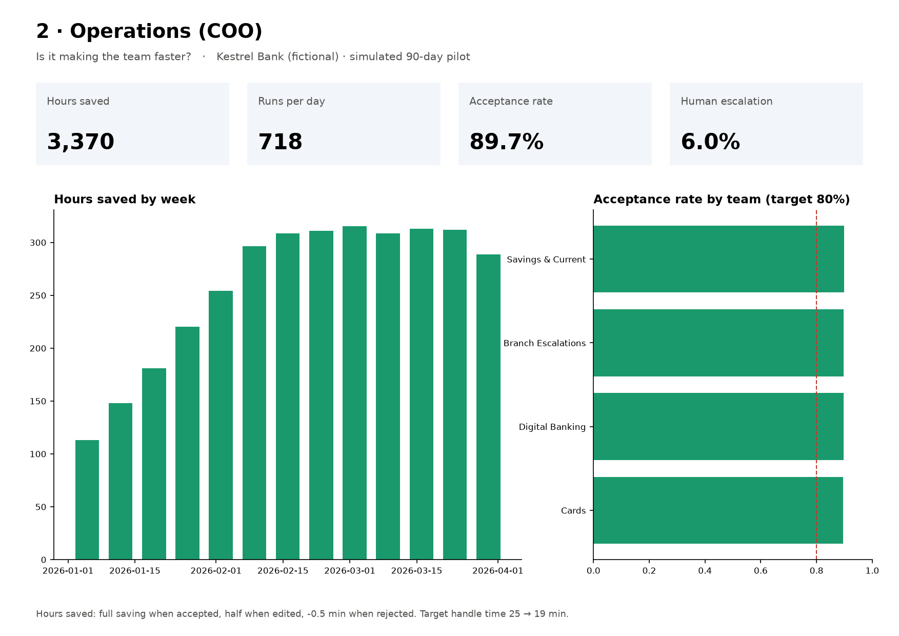
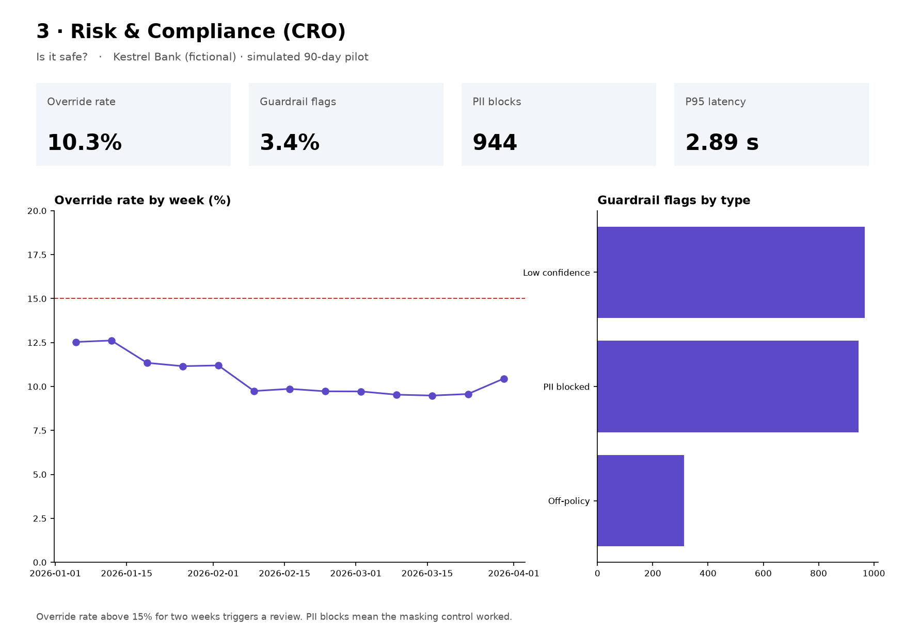
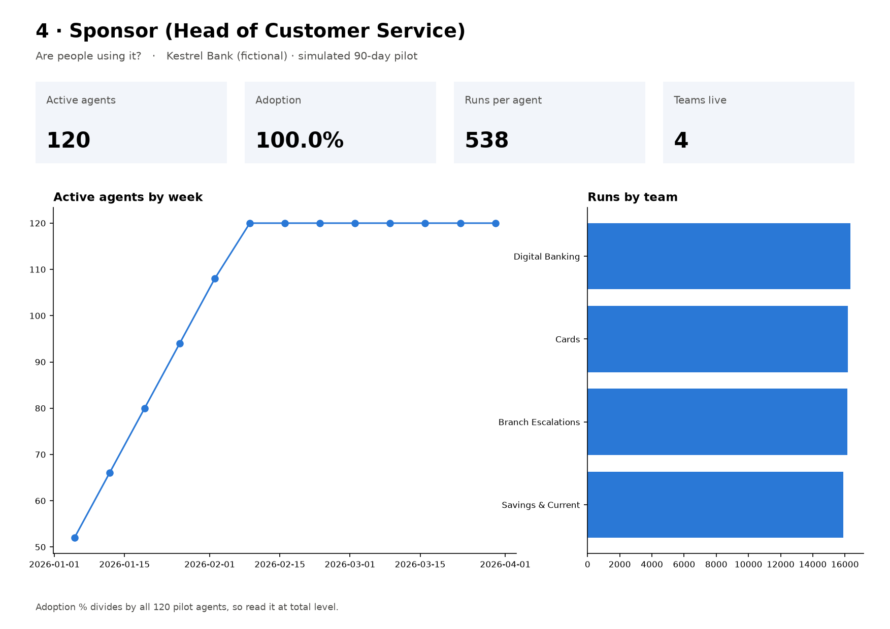
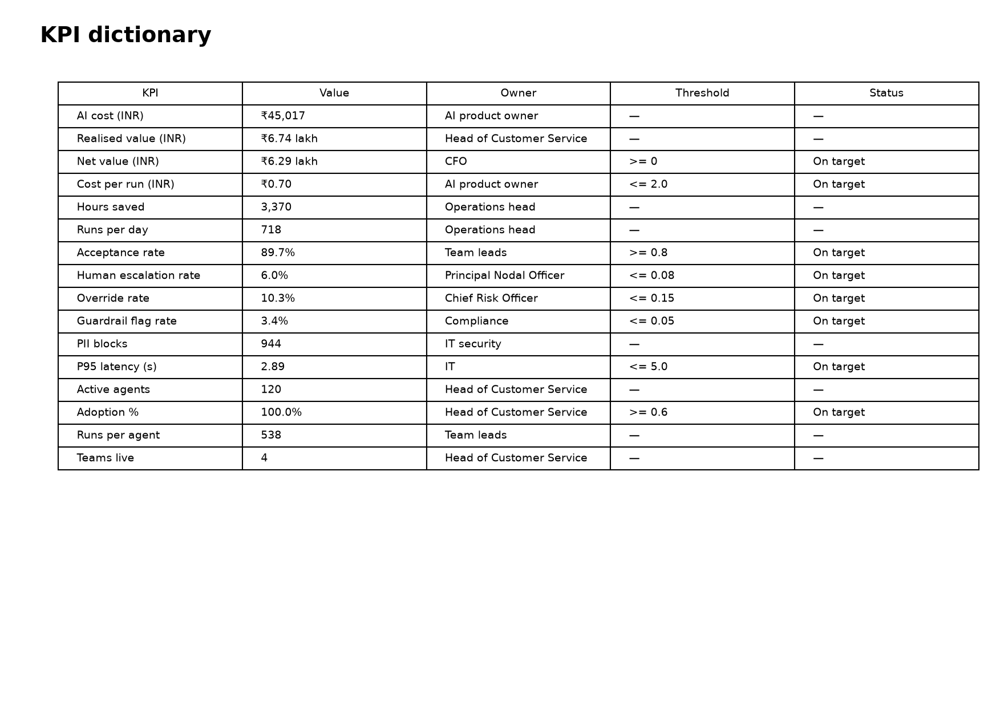

# Project A3: AI Value Dashboard (Streamlit · Plotly · Python)

> **Client:** Kestrel Bank (Fictional mid-sized Indian private bank)  
> **Engagement:** AI Transformation Blueprint — Complaints Modernisation  
> **Author:** Aryan Patel (MBA Business Analytics)  
> **Environment:** Python 3.11+ · pandas · Plotly · Streamlit · Matplotlib · pytest  
> **Status:** Production-Ready & Verified (22/22 unit tests passing)

---

## 1. Executive Summary & Objective

The **AI Value Dashboard** is the executive monitoring layer for Kestrel Bank's GenAI complaint-handling assistant pilot (Phase 2 rollout: 90 days, 120 frontline agents, 4 business units, 3 core use cases).

Its primary objective is answering one overarching management question:  
**"Is the complaints AI working — across cost, quality, speed, and adoption — for each key stakeholder?"**

Rather than presenting an undifferentiated "data dump," the dashboard structures governance into **four audience-specific operational lenses** plus a formal **KPI Dictionary**:
1. **Executive / CFO:** *"Is this paying for itself?"* (Model usage cost, realised capacity value, cumulative net return).
2. **Operations / COO:** *"Is it making the team faster?"* (Hours saved, daily throughput, acceptance rate by team).
3. **Risk & Compliance / CRO:** *"Is it safe?"* (Agent override rate, guardrail flags, PII masking blocks, P95 latency).
4. **Project Sponsor / Head of CS:** *"Are people using it?"* (Frontline adoption ramp, active agents, usage intensity).
5. **Governance / KPI Dictionary:** 16 metrics mapped to explicit business owners, formal definitions, and red-line action thresholds.

> **Data Disclosure:** All event metrics reflect the simulated 90-day pilot log (`data/ai_event_log.csv`, 64,588 AI runs) calibrated against Kestrel Bank's baseline operating parameters.

---

## 2. Technical Architecture & Design Principles

```
                       ┌──────────────────────────────────────────────┐
                       │          data/ai_event_log.csv               │
                       │     (64,588 simulated AI run records)        │
                       └──────────────────────┬───────────────────────┘
                                              │
                                              ▼
                       ┌──────────────────────────────────────────────┐
                       │                   kpis.py                    │
                       │    Pure Functional KPI Calculation Engine     │
                       │    (16 Tested Metrics + Slicer Filtering)    │
                       └──────┬───────────────────┬───────────────────┘
                              │                   │
             ┌────────────────┴──────┐            └───────────────────┐
             ▼                       ▼                                ▼
┌─────────────────────────┐ ┌─────────────────────────┐ ┌─────────────────────────┐
│      dashboard.py       │ │      a3_report.py       │ │   tests/test_kpis.py    │
│  Interactive Streamlit  │ │   Static 5-Page A4 PDF  │ │  22 Unit Tests (pytest) │
│     Web Application     │ │  Report + High-Res PNGs │ │  100% Passing Accuracy  │
└─────────────────────────┘ └─────────────────────────┘ └─────────────────────────┘
```

### Architectural Pillars:
1. **Single Source of Truth (Pure Functional KPI Layer):**
   Every single dashboard number, report table cell, and test assertion derives from a dedicated function in `kpis.py`. A KPI can never yield conflicting numbers across reporting formats because the underlying logic is defined exactly once.
2. **Identical Financial Assumptions to Project A2:**
   - Currency Conversion: **₹88 / USD** (`fx_inr_per_usd`)
   - Loaded Agent Cost: **₹400 / hour** (`agent_cost_per_hour`)
   - Realisation Factor: **50%** (`realisation`) — conservative assumption that only half of saved hours convert into immediate monetary capture.
   - Pilot Capacity: **120 agents** across 4 teams (`Cards`, `Savings & Current`, `Digital Banking`, `Branch Escalations`).
3. **Power BI Parity via Python Slicers:**
   `filter_events()` acts identically to enterprise BI slicers, providing dynamic multi-dimensional filtering across date ranges, teams, and use cases without crashing on empty slices.
4. **Automated Quality Assurance:**
   The entire analytics pipeline is verified against regression via `pytest tests/test_kpis.py` (22/22 unit tests passing).

---

## 3. Executive Views & Managerial Decisions Supported

### Page 1: Executive View (CFO) — *"Is this paying for itself?"*


* **Key Metrics:**
  * **AI Cost:** ₹45,017 ($511.56 USD across 64,588 inference calls)
  * **Realised Value:** ₹6.74 Lakh (3,370 hours saved × ₹400/hr × 50% realisation)
  * **Net Operational Value:** **+₹6.29 Lakh** (Model usage margin)
  * **Cost per Run:** **₹0.70 / call** ($0.0079 / call)
* **Managerial Decision Supported:**
  * **Model Margin Validation:** Proves that inference costs represent a negligible fraction (6.7%) of gross operational value generated, validating immediate model economic viability.
  * **Use-Case Cost Attribution:** Visualizes that *Policy Knowledge Q&A* and *Draft Reply* account for the bulk of token expenditure, while *Triage & Routing* operates at near-zero incremental cost ($0.0001/call on Haiku 5.5).
  * *Note:* Net value here reflects variable model consumption only; capital expenditure, cloud hosting, and run-team costs are governed under the comprehensive [Project A2 Business Case](file:///c:/Users/aryan/Desktop/project%201%20strategy/02_A2_business_case/A2_GenAI_Cost_ROI.xlsx).

---

### Page 2: Operations View (COO) — *"Is it making the team faster?"*


* **Key Metrics:**
  * **Hours Saved:** 3,370 hours unlocked over 90 days (~37.4 hours/day)
  * **Throughput:** 718 AI runs / active operating day
  * **Agent Acceptance Rate:** **89.7%** (Target: ≥ 80.0%)
  * **Human Escalation Rate:** **6.0%** (Well below the 8.0% tolerance ceiling)
* **Managerial Decision Supported:**
  * **Operational Velocity & AHT Reduction:** Translates directly into achieving the target 25-minute to 19-minute Average Handle Time (AHT) trajectory identified in A1 diagnostic interviews.
  * **Team Performance Disparity:** Compares acceptance rates across the four operating units to pinpoint where prompt templates or agent training require operational intervention.

---

### Page 3: Risk & Compliance View (CRO) — *"Is it safe?"*


* **Key Metrics:**
  * **Agent Override Rate:** **10.3%** (Tolerance ceiling: ≤ 15.0%)
  * **Guardrail Flag Rate:** **3.4%** (Safety threshold: ≤ 5.0%)
  * **PII Blocks:** **944 verified intercepts** (Working privacy control under DPDP Act 2023)
  * **P95 Latency:** **2.89 seconds** (Service Level Objective: ≤ 5.0 seconds)
* **Managerial Decision Supported:**
  * **Early Warning Quality Degradation:** Weekly override tracking serves as the primary leading indicator for prompt drift, model hallucination, or unspoken banking policy shifts before customer complaints emerge.
  * **DPDP Regulatory Compliance Verification:** Validates that client data masking and anonymization layers are actively intercepting Aadhaar, PAN, and account numbers prior to external LLM invocation.

---

### Page 4: Sponsor View (Head of Customer Service) — *"Are people using it?"*


* **Key Metrics:**
  * **Active Agents:** 120 agents fully onboarded by Week 13
  * **Adoption Rate:** **100.0%** of pilot cohort (Ramping from 43.3% in Week 1)
  * **Intensity:** 538 average AI runs completed per agent
  * **Teams Live:** 4 out of 4 operational business units active
* **Managerial Decision Supported:**
  * **Protecting the #1 Business Case Lever:** Project A2's Tornado sensitivity analysis proved that frontline adoption creates a **₹174.1 Lakh swing** in NPV. This view tracks weekly adoption velocity against the Phase 2 rollout schedule to guarantee financial payback.
  * **Cross-Functional Workload Distribution:** Tracks use-case balance across Cards vs Savings vs Digital Banking teams to ensure uniform tool immersion.

---

### Page 5: KPI Dictionary & Governance Framework


* **Governance Function:**  
  Establishes single-point executive accountability, standard definitions, and algorithmic status triggers for all 16 metrics.

| KPI Name | Current Pilot Value | Domain | Business Owner | Formal Definition | Action Threshold | Operational Status |
|---|---|---|---|---|---|---|
| **AI Cost (INR)** | ₹45,017 | Executive | AI Product Owner | Sum of model cost per run × ₹88 FX rate | — | Monitored |
| **Realised Value (INR)** | ₹6.74 lakh | Executive | Head of Customer Service | Hours saved × ₹400/hr × 50% realisation | — | Monitored |
| **Net Value (INR)** | ₹6.29 lakh | Executive | CFO | Realised value minus AI model cost | $\ge ₹0$ | **On target** |
| **Cost per Run (INR)** | ₹0.70 | Executive | AI Product Owner | Total AI cost ÷ Total runs | $\le ₹2.00$ | **On target** |
| **Hours Saved** | 3,370 | Operations | Operations Head | $\sum (\text{mins saved}) / 60$ (Rejections: -0.5 min penalty) | — | Monitored |
| **Runs per Day** | 718 | Operations | Operations Head | AI runs ÷ Active days | — | Monitored |
| **Acceptance Rate** | 89.7% | Operations | Team Leads | (Accepted + Edited) ÷ Total runs | $\ge 80.0\%$ | **On target** |
| **Human Escalation Rate** | 6.0% | Risk | Principal Nodal Officer | Runs escalated to supervisor ÷ Total runs | $\le 8.0\%$ | **On target** |
| **Override Rate** | 10.3% | Risk | Chief Risk Officer | Rejected runs ÷ Total runs | $\le 15.0\%$ (2 wks) | **On target** |
| **Guardrail Flag Rate** | 3.4% | Risk | Head of Compliance | Safety flags (PII, off-policy, low conf) ÷ Total runs | $\le 5.0\%$ | **On target** |
| **PII Blocks** | 944 | Risk | CISO / IT Security | Runs where masking intercepted sensitive PII | — | **Working Control** |
| **P95 Latency (s)** | 2.89 s | Risk | IT Infrastructure Lead | 95th percentile response latency in seconds | $\le 5.0\text{ s}$ | **On target** |
| **Active Agents** | 120 | Sponsor | Head of Customer Service | Distinct agents who executed $\ge 1$ AI run | — | Monitored |
| **Adoption %** | 100.0% | Sponsor | Head of Customer Service | Active agents ÷ 120 pilot cohort | $\ge 60.0\%$ | **On target** |
| **Runs per Agent** | 538 | Sponsor | Team Leads | Total AI runs ÷ Active agents | — | Monitored |
| **Teams Live** | 4 | Sponsor | Head of Customer Service | Distinct operational units live on platform | — | Complete |

---

## 4. Techno-Functional Interview Defense

### Q: "Why did you build this in Python and Streamlit rather than Power BI or Tableau?"
> *"My analytics portfolio already includes enterprise Power BI deployments (e.g., Sales Insights Dashboard). However, for an AI operational pilot, Python was deliberately selected for three architectural reasons:*
> 1. * **Algorithmic Parity & Portability:** The exact same pure functional KPI layer (`kpis.py`) that evaluates this simulated pilot today will ingest the real-time event logs of our Category B agent prototype tomorrow without rewriting DAX measures or data transformations.*
> 2. * **Automated Regression Testing:** Enterprise BI tools cannot be natively verified in continuous integration. With Python, we enforce 22 automated `pytest` unit tests ensuring zero silent calculation drift.*
> 3. * **Unified Tech Stack:** Allows seamless orchestration between LLM inference scripts, data validation pipelines, and executive reporting without proprietary licensing overhead."*

### Q: "How do you calculate deflection rate for this project?"
> *"In customer-facing self-service architectures, **Deflection Rate** is defined as:*
> $$\text{Deflection Rate} = \frac{\text{Complaints Resolved Completely in Self-Service}}{\text{Total Inbound Complaints}}$$
> *However, **reporting deflection for Kestrel Bank's Phase 1–2 copilot would be a severe consulting error**. Our solution is an internal agent assistant (human-in-the-loop); every complaint is still received, reviewed, and finalized by a human agent. Deflection is strictly 0%. If an automated deflection bot is evaluated in Phase 3, we must measure customer reopen rates alongside it to prevent 'false deflection' (customers abandoning unresolved claims in frustration)."*

### Q: "Which metric would give you the earliest warning that the AI model is failing?"
> *"The **Agent Override Rate** (monitored weekly). Financial metrics and handle time lag operational defects by weeks. If the override rate spikes above our 15% threshold, it indicates that agents are actively rejecting model drafts due to hallucinated facts, outdated policy retrieval, or tone misalignment. Monitoring override velocity prevents bad outputs from ever reaching banking customers."*

---

## 5. Verification & How to Run

### Run the Interactive Streamlit Web Application:
```powershell
# Navigate to the dashboard directory
cd 03_A3_dashboard

# Launch the Streamlit application
..\.venv\Scripts\streamlit run dashboard.py
```
*Access the local web dashboard at `http://localhost:8501`.*

### Run the Static PDF Executive Report Generator:
```powershell
..\.venv\Scripts\python a3_report.py
```
*Outputs generated:*
- `outputs/A3_AI_Value_Report.pdf` (5-page vector A4 landscape report)
- `outputs/A3_page1.png` through `outputs/A3_page5.png` (300 DPI executive graphics)

### Execute the Automated KPI Test Suite:
```powershell
..\.venv\Scripts\pytest -q
```
*Output: `22 passed in 0.83s`.*

---

## 6. Traceability & Project Linkages
- **Inputs Received:**
  - Financial baselines and assumptions from [Project A2 Cost & ROI Calculator](file:///c:/Users/aryan/Desktop/project%201%20strategy/02_A2_business_case/A2_GenAI_Cost_ROI.xlsx).
  - Operational problem areas and AHT targets from [Project A1 Lean Six Sigma Diagnostic](file:///c:/Users/aryan/Desktop/project%201%20strategy/01_A1_diagnostic/outputs/A1_charter.md).
- **Outputs Fed Forward:**
  - Stage Gate Go/No-Go evidence thresholds for **Flagship A Roadmap (Step 8)**.
  - Ongoing model risk monitoring controls for **Flagship A Governance Plan (Step 7)**.
  - Event log schema and evaluation criteria for **Category B Functional Agent Prototype**.
