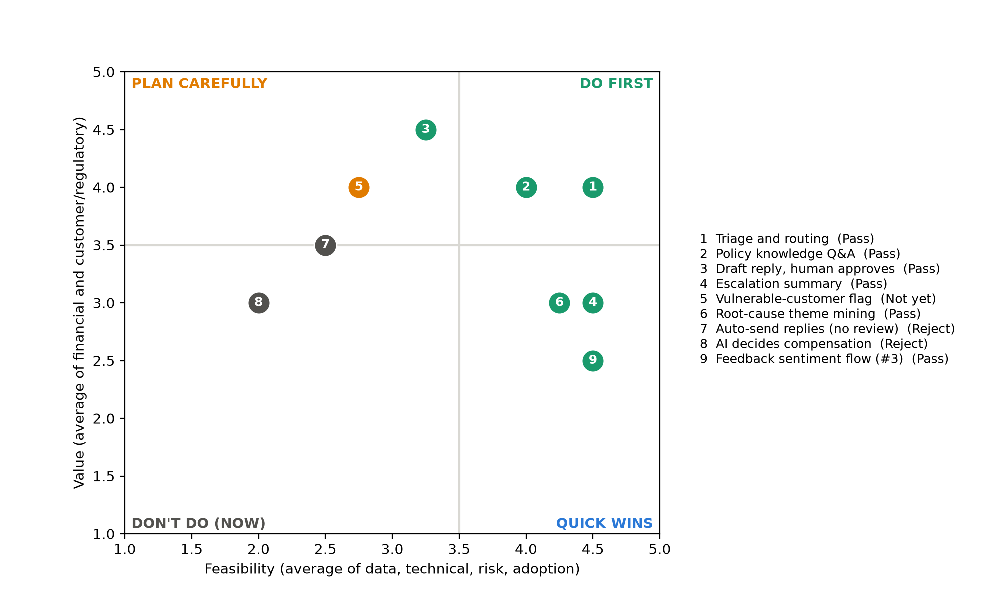

# Use-Case Prioritisation: Decision Ladder & Evaluation Matrix (use_case_prioritisation.md)

> **Client:** Kestrel Bank  
> **Engagement:** AI Transformation Blueprint — Complaints Redressal Modernisation  
> **Prepared by:** Aryan Patel (MBA Business Analytics, Techno-Functional Consultant)  
> **Deliverable:** Flagship Step 5 — Use-Case Long List, Decision Ladder, 6-Criterion Scorecard & Matrix  
> **Output Artifact:** `04_FlagshipA/outputs/value_vs_feasibility.png`

---

## 1. The Consultant's AI Decision Ladder

A critical hallmark of management consulting maturity is **technological frugality**: refusing to deploy complex, expensive generative AI models when a simpler, deterministic, or classical tool solves the business problem. 

Every candidate complaint-handling use case must climb the **AI Decision Ladder** from bottom to top, stopping at the **first (cheapest and lowest-risk) rung** that completely resolves the operational pain point:

```
  [ RUNG 5: AUTONOMOUS AGENT ]  ──► End-to-end task execution without human mediation (Highest risk & cost)
             ▲
  [ RUNG 4: LLM / RAG ]         ──► Generative AI, natural language synthesis, semantic vector search
             ▲
  [ RUNG 3: CLASSICAL ML ]      ──► Supervised classification (scikit-learn), clustering, statistical NLP
             ▲
  [ RUNG 2: DETERMINISTIC RULES]──► Business logic, SLA countdowns, regex, threshold gateways
             ▲
  [ RUNG 1: LEAN PROCESS FIX ]  ──► Policy changes, discretionary limits, standard operating procedures
```

### Application of the Decision Ladder Across the 9 Long-Listed Use Cases

| # | Candidate Use Case | Addressed Pain Point | Lowest Rung That Works | Technical & Architectural Rationale | Decision Outcome |
|---|---|---|---|---|---|
| **1** | **Triage & Queue Routing** | **P2** (Misrouting; 20% re-routes) | **Small LLM (Now) $\to$ Classical ML (Later)** | The bank's CRM currently lacks standardized dispute labels (discovered in A1), meaning there is no clean training data for supervised ML today. Deploy Claude Haiku 5.5 now; once 6 months of structured data is collected, migrate to a cheaper local scikit-learn classifier. | **Pass (Phase 1)** |
| **2** | **Policy Knowledge Q&A** | **P1** (4 systems; 8 min lookup) | **LLM + RAG** | Banking circulars and master directions change continuously and require exact clause citations. Pure rules cannot handle natural language queries across 500+ PDF pages. Requires semantic vector retrieval with prompt caching. | **Pass (Phase 1)** |
| **3** | **Response Drafting** | **P3** (Drafting from scratch; 8.5 min) | **LLM + Human Approval** | Free-text generation requiring empathy, factual synthesis, and legal accuracy. Rules produce robotic templates; LLM drafting saves 6 min per case, while mandatory human sign-off neutralizes hallucination risk. | **Pass (Phase 2)** |
| **4** | **Escalation Case Summary** | **P4** (30-day statutory drift) | **LLM** | Synthesizes sprawling, unstructured chronological notes across operations, fraud, and branch teams into an executive timeline for Nodal Officers. | **Pass (Phase 2 Quick Win)** |
| **5** | **Vulnerable-Customer Flag** | Customer Protection | **Rules + Classical ML + Human** | Identifying bereavement, severe illness, or financial distress requires strict objective criteria and algorithmic fairness audits to avoid discriminatory bias. GenAI is too unpredictable. | **Plan Carefully (Deferred)** |
| **6** | **Root-Cause Theme Mining** | **P5** (Repeat systemic defects) | **Classical ML (Batch)** | Unsupervised TF-IDF + K-Means clustering (as demonstrated in Project A1) run as an offline monthly batch script. Zero generative AI required except for generating short cluster labels. | **Pass (Phase 0 Quick Win)** |
| **7** | **Auto-Send Replies (No Review)** | Customer Communication | **Not Recommended** | Customer communications carry statutory legal enforceability under RB-IOS 2026. The cost of a single hallucinated settlement or regulatory error exceeds any marginal labor savings. | **STRICT REJECT** |
| **8** | **AI Decides Compensation** | Financial Settlements | **Rules + Human Approval** | Setting financial compensation limits is an internal credit and audit policy decision. Core banking financial adjustments must never be delegated to probabilistic LLM weights. | **STRICT REJECT** |
| **9** | **Feedback Sentiment Flow** | Service Quality | **Prebuilt AI (Power Automate)** | Standardized post-resolution feedback scoring. Already implemented in portfolio project #3 (Client Feedback Automation) via low-code connectors. | **Pass (Phase 0 Quick Win)** |

---

## 2. Six-Criterion Evaluation Scorecard

Candidate use cases are scored from **1 (lowest / worst)** to **5 (highest / best)** across six balanced dimensions. 
* **Go / No-Go Threshold Rule:** A use case achieves **PASS** if and only if:
  1. Total Score $\ge \mathbf{20 \text{ out of } 30}$; **AND**
  2. **Zero Criteria Score a 1** (a score of 1 represents a fatal risk or unviable hurdle that automatically triggers rejection).
* **Axes Calculation:**
  $$\text{Value Axis} = \frac{\text{Financial Value} + \text{Customer/Regulatory Impact}}{2}$$
  $$\text{Feasibility Axis} = \frac{\text{Data Readiness} + \text{Technical Feasibility} + \text{Risk (5=Low)} + \text{Adoption Readiness}}{4}$$

### Comprehensive Scorecard Matrix (From `Flagship_A_templates.xlsx`)

| # | Candidate Use Case | Financial Value | Customer / Reg Impact | Data Readiness | Technical Feasibility | Risk Score (5=Low) | Adoption Readiness | Total Score | Value Axis (Y) | Feasibility Axis (X) | Governance Result |
|---|---|---|---|---|---|---|---|---|---|---|---|
| **1** | **Triage & Routing** | 4 | 4 | 5 | 5 | 4 | 4 | **26 / 30** | **4.00** | **4.50** | **PASS (Do First)** |
| **2** | **Policy Knowledge Q&A** | 4 | 4 | 4 | 4 | 4 | 4 | **24 / 30** | **4.00** | **4.00** | **PASS (Do First)** |
| **3** | **Draft Reply (Human Approves)** | 5 | 4 | 4 | 3 | 3 | 3 | **22 / 30** | **4.50** | **3.25** | **PASS (Plan Carefully)** |
| **4** | **Escalation Summary** | 3 | 3 | 5 | 5 | 4 | 4 | **24 / 30** | **3.00** | **4.50** | **PASS (Quick Win)** |
| **5** | **Vulnerable-Customer Flag** | 3 | 5 | 3 | 3 | 2 | 3 | **19 / 30** | **4.00** | **2.75** | **NOT YET (Total < 20)** |
| **6** | **Root-Cause Theme Mining** | 3 | 3 | 4 | 4 | 5 | 4 | **23 / 30** | **3.00** | **4.25** | **PASS (Quick Win)** |
| **7** | **Auto-Send Replies (No Review)** | 5 | 2 | 4 | 3 | **1** | 2 | **17 / 30** | **3.50** | **2.50** | **REJECT (Fatal Risk = 1)** |
| **8** | **AI Decides Compensation** | 4 | 2 | 3 | 2 | **1** | 2 | **14 / 30** | **3.00** | **2.00** | **REJECT (Fatal Risk = 1)** |
| **9** | **Feedback Sentiment Flow (#3)** | 2 | 3 | 4 | 5 | 5 | 4 | **23 / 30** | **2.50** | **4.50** | **PASS (Quick Win)** |

---

## 3. Value-vs-Feasibility Prioritisation Matrix

The resulting scatter plot partitions the transformation portfolio into four actionable operational quadrants:



```
HIGH VALUE (Y >= 3.5)
     │
     │      [PLAN CAREFULLY]                  [DO FIRST]
     │   • #3 Draft Reply (Human Approves)  • #1 Triage & Routing
     │   • #5 Vulnerable-Customer Flag      • #2 Policy Knowledge Q&A
     │
─────┼──────────────────────────────────────────────────────────
     │
     │      [DON'T DO / REJECT]               [QUICK WINS]
     │   • #7 Auto-Send Replies (Risk=1)    • #4 Escalation Summary
     │   • #8 AI Decides Comp (Risk=1)      • #6 Root-Cause Theme Mining
     │                                      • #9 Feedback Sentiment Flow
     │
LOW VALUE ────────────────────────────────────────────── HIGH FEASIBILITY (X >= 3.5)
```

### Strategic Phasing Allocation:
1. **DO FIRST (High Value, High Feasibility):**
   * **Use Case #1 (Triage & Routing):** Low cost ($0.0001/call on Haiku), zero customer risk, immediately eliminates 20% misrouting delay. Roll out in Phase 1.
   * **Use Case #2 (Policy Knowledge Q&A):** RAG architecture with Anthropic prompt caching ($0.017/call); saves 6.5 minutes of search time per complaint. Roll out in Phase 1.
2. **PLAN CAREFULLY (High Value, Moderate Feasibility):**
   * **Use Case #3 (Draft Reply):** Delivers the highest individual labor saving (6.0 min/call), but requires rigorous prompt engineering, change management, and enforceable Human-in-the-Loop review gates. Roll out in Phase 2.
3. **QUICK WINS (Moderate Value, High Feasibility):**
   * **Use Case #4 (Escalation Summary), #6 (Theme Mining), #9 (Feedback Flow):** Implemented in Phase 0 to build institutional momentum without large capital outlays.
4. **DON'T DO / REJECT (Fatal Risk = 1):**
   * **Use Cases #7 and #8:** Explicitly barred from implementation.

---

## 4. Deep-Dive: What NOT to Automate (Consulting Judgement)

Interviewers probe candidates to see if they are "GenAI hype chasers" or rigorous risk managers. We explicitly document two negative boundaries:

### Negative Boundary 1: Auto-Sending Replies Without Human Review (#7)
* **Scorecard Trigger:** Risk Score = **1 (Fatal)** $\implies$ **Automatic Rejection**.
* **Consulting Rationale:** Under Section 16 of the RBI Integrated Ombudsman Scheme (RB-IOS 2026), written representations made by a regulated entity during dispute resolution form binding legal evidence in conciliation proceedings. A hallucinated promise of compensation, an incorrect interpretation of a chargeback rule, or an inappropriate conversational tone directly triggers regulatory fines, customer litigation, and reputational damage. The marginal efficiency gain of eliminating human sign-off (2 minutes) is dwarfed by the downside liability.

### Negative Boundary 2: Autonomous AI Compensation & Fee Waivers (#8)
* **Scorecard Trigger:** Risk Score = **1 (Fatal)** $\implies$ **Automatic Rejection**.
* **Consulting Rationale:** Reversing fees or issuing monetary goodwill compensation involves direct debits from bank income accounts. Probabilistic models are inherently vulnerable to prompt injection, edge-case hallucinations, and adversarial manipulation (e.g., customers crafting grievance text designed to trigger maximum payout rules). Compensation authority must remain governed by **deterministic policy limits** (Non-AI Fix #4: frontline agents empowered up to ₹1,500; supervisor approval required above ₹1,500).

---

## 5. Executive Defense: "Why Didn't You Recommend an Autonomous Agent (`[AG]`)?"

> **Consultant's Interview Script:**  
> *"We evaluated an autonomous agent architecture, but our **AI Decision Ladder** stopped at Rung 4 (LLM Copilot with Human Sign-Off).  
> In banking dispute operations, every single high-value step is either:  
> 1. A knowledge lookup against changing policy (solved cheaper and safer by RAG);  
> 2. A draft communication that requires human empathy and legal accountability; or  
> 3. A financial decision governed by bank delegations of authority.  
>  
> An autonomous agent (`[AG]`) introduces independent action loops and tool-calling execution paths. In this domain, autonomy adds exponential regulatory and operational risk under **RBI FREE-AI guidelines**, without solving any bottleneck that our empirical diagnostic uncovered.  
> Saying 'no' to autonomous agents in Phase 1–2 is not a limitation—it is the exact risk-adjusted judgement that protects the bank's balance sheet."*
